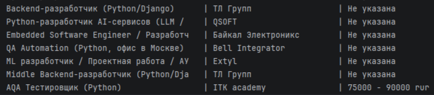

# Парсер вакансий

Скрипт на Python для получения информации о вакансиях с сайта «Хабр Карьера» (career.habr.com).

## Версии
- **v1.0** — Парсинг HTML-страницы с вакансиями (получение данных через `requests` и `BeautifulSoup`).
- **v2.0** — Переход на публичное API Хабр Карьеры (формат JSON). Работает быстрее и надежнее.

## Возможности (v2.0)
- Поиск вакансий по ключевому слову (например, «Python»).
- Получение данных в формате JSON через публичное API.
- Вывод названия вакансии, компании и зарплаты.
- Обработка ошибок сети и таймаутов.
- Красивое форматирование зарплаты (от, до, диапазон).

## Скриншоты

### Версия 1.0 (HTML-парсинг)
**Вывод в консоли (реальные вакансии с Хабра):**


### Версия 2.0 (API + JSON)
**Вывод в консоли (реальные вакансии через API):**


## Структура проекта
```text
Vacancy-Parser/
├── parser_v1_html.py    # Версия 1.0 (Парсинг HTML Хабр Карьеры)
├── parser_v2_api.py     # Версия 2.0 (Работа через API + JSON)
├── README.md            # Описание проекта
├── CHANGELOG.md         # История версий
├── .gitignore           # Исключения (__pycache__ и др.)
└── screenshots/         # Скриншоты работы
    ├── v1_habr_console.png
    └── v2_habr_api_output.png
```

## Стек
- Python 3.15+
- `requests` — для HTTP-запросов.
- `beautifulsoup4` — для парсинга HTML.

## Установка и запуск
```bash
# 1. Клонируйте репозиторий и перейдите в папку проекта
git clone https://github.com/Ramzesoff/Vacancy-Parser.git
cd Vacancy-Parser

# 2. Установите зависимости
pip install requests beautifulsoup4

# 3. Запустите скрипт
python parser_v1_html.py

# Для v2.0 (API + JSON):
python parser_v2_api.py
```

## Чему я научился
- Работа с библиотекой requests для скачивания веб-страниц и работы с API.
- Использование BeautifulSoup для поиска элементов в HTML по классам.
- Работа с REST API и форматом JSON.
- Обработка ошибок сети (try/except) и таймаутов.
- Форматирование данных для вывода в консоль (выравнивание по ширине).
