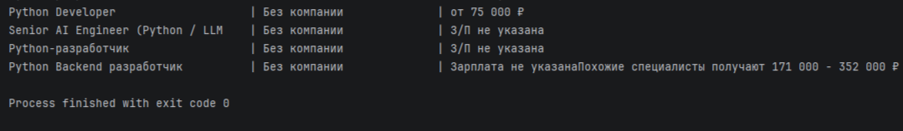

# Парсер вакансий

Скрипт на Python для получения информации о вакансиях с сайта «Хабр Карьера» (career.habr.com).

## Версии
- **v1.0** — Парсинг HTML-страницы с вакансиями (получение данных через `requests` и `BeautifulSoup`).

## Возможности (v1.0)
- Поиск вакансий по ключевому слову (например, «Python»).
- Извлечение названия вакансии, компании и зарплаты из HTML-кода.
- Красивое форматирование вывода в консоль.
- Обработка ошибок сети и таймаутов.

## Скриншоты

### Версия 1.0 (HTML-парсинг)
**Вывод в консоли (реальные вакансии с Хабра):**


## Структура проекта
```text
Vacancy-Parser/
├── parser_v1_html.py    # Версия 1.0 (Парсинг HTML Хабр Карьеры)
├── README.md            # Описание проекта
├── CHANGELOG.md         # История версий
├── .gitignore           # Исключения (__pycache__ и др.)
└── screenshots/         # Скриншоты работы
    └── v1_habr_console.png
```

## Стек
- Python 3.15+
- `requests` — для HTTP-запросов.
- `beautifulsoup4` — для парсинга HTML.

## Установка и запуск
```bash
# 1. Клонируйте репозиторий и перейдите в папку проекта
git clone https://github.com/Ramzesoff/Vacancy-Parser.git
cd Vacancy-Parser

# 2. Установите зависимости
pip install requests beautifulsoup4

# 3. Запустите скрипт
python parser_v1_html.py
```

## Чему я научился (v1.0)
- Работа с библиотекой `requests` для скачивания веб-страниц.
- Использование `BeautifulSoup` для поиска элементов в HTML.
- Понимание проблемы: сайты, которые грузят данные через JavaScript, не отдают вакансии в исходном HTML.
- Обработка ошибок сети (`try/except`).